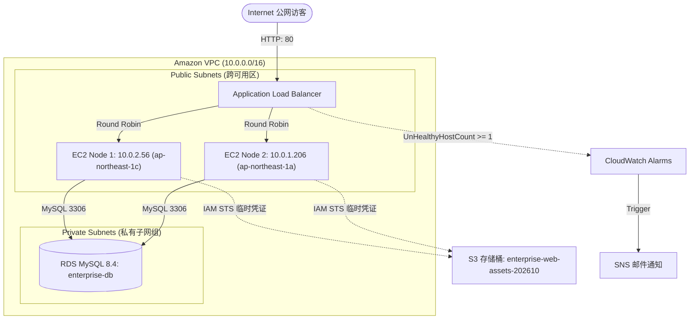
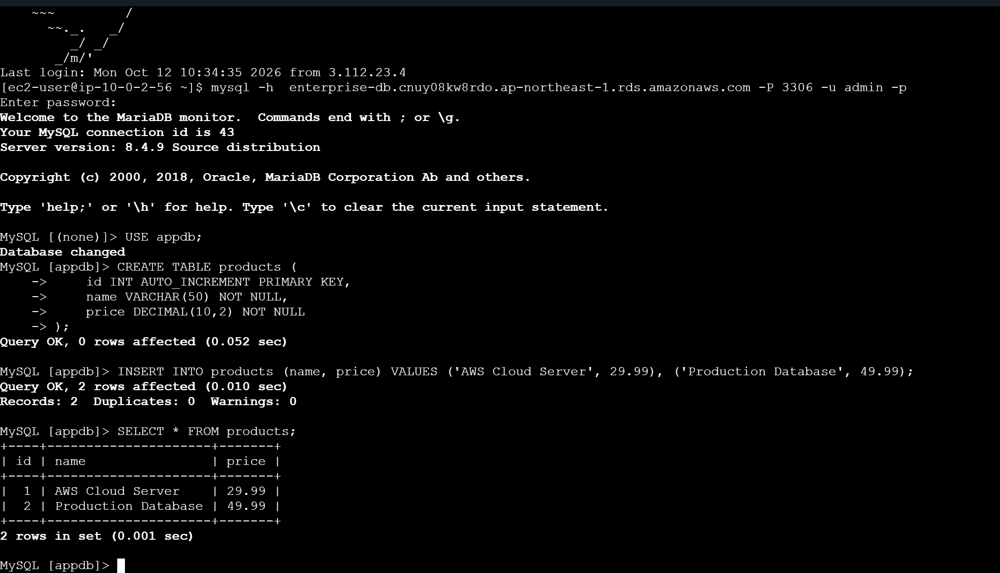
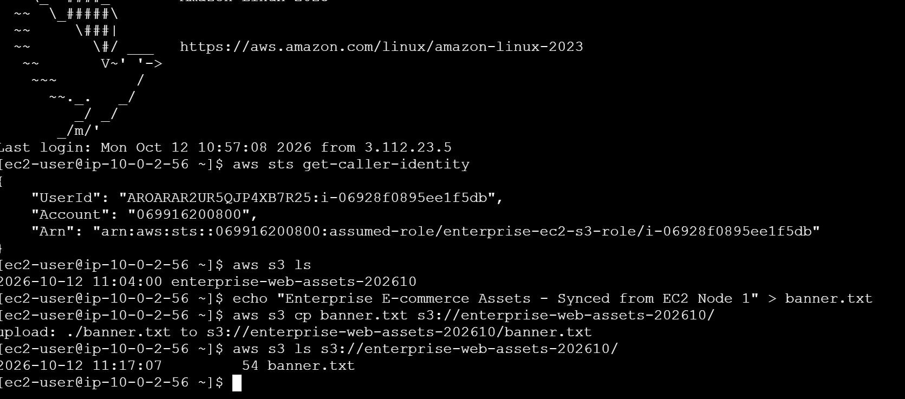
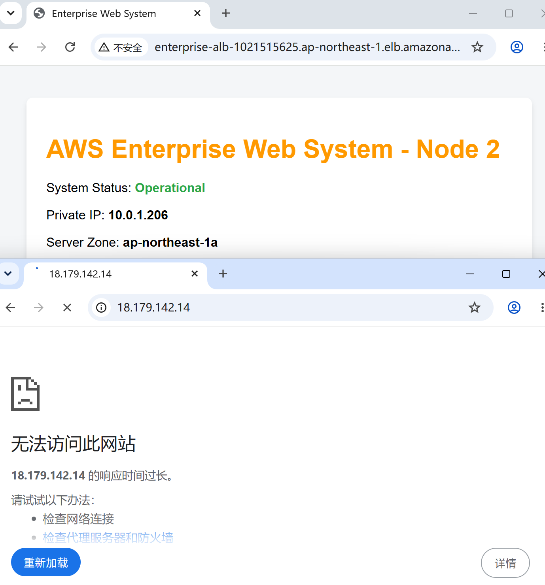
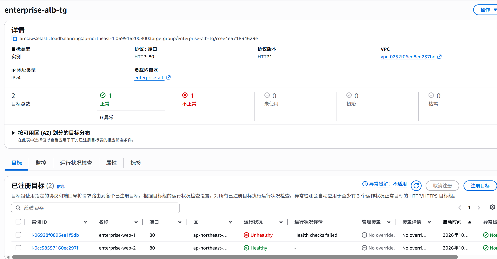
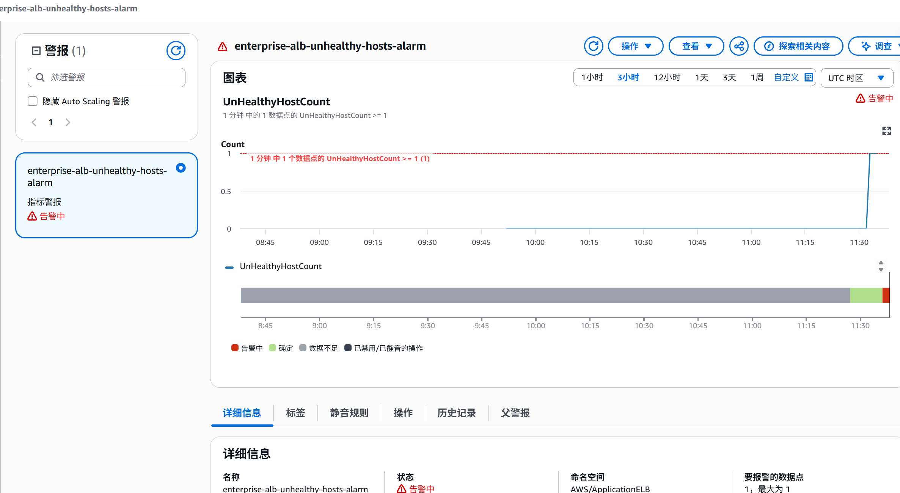

# AWS 企业网站云迁移与高可用架构实践

AWS Enterprise Web Application Cloud Migration & High-Availability Architecture

本项目模拟中小型电商网站的云迁移场景，使用 AWS 搭建跨可用区的 Web 计算层，并结合 ALB、RDS、S3、IAM 和 CloudWatch 实践负载均衡、网络访问控制、数据存储与故障告警。数据库采用 Single-AZ 部署，以控制实验成本。


## 一、 项目背景与业务痛点 (Business Context)

本项目模拟一家中小型电商企业的核心系统上云改造演练。原系统运行于传统 IDC 单台裸金属物理服务器，随着线上访问量增长，面临以下架构瓶颈：
1. **单点故障（SPOF）**：Web 容器（Nginx）与数据库单机混部，缺乏高可用冗余，单点宕机即导致全站瘫痪。
2. **缺乏弹性扩展能力**：无状态应用与有状态持久化数据强绑定，无法应对流量突增时的横向伸缩。
3. **安全边界扁平**：核心数据库与 Web 应用共用公网出入口，缺乏网络层与传输层的隔离防护。
4. **监控与告警滞后**：依赖人工巡检，缺乏端到端指标联动与故障检测与告警能力。

本项目使用 AWS 搭建了一个简单的网站架构，主要实践了跨可用区部署 EC2、使用 ALB 分发请求、通过安全组限制访问，以及利用 IAM Role 访问 S3。最后通过停止 Nginx 服务，观察 ALB 的健康检查和流量切换情况。
---

## 二、 架构拓扑设计 (Architecture Topology)



## 三、 基础设施与配置参数规范 (Infrastructure Matrix)

### 1. 网络与子网拓扑 (Network Topology)
- **VPC**：`enterprise-web-vpc`（CIDR: `10.0.0.0/16`，启用 DNS 主机名与 DNS 解析）
- **公有子网（前端接入层）**：
  - `enterprise-public-sub-1`：`10.0.1.0/24` | 位于可用区 `ap-northeast-1a`（绑定 IGW 路由）
  - `enterprise-public-sub-2`：`10.0.2.0/24` | 位于可用区 `ap-northeast-1c`（绑定 IGW 路由）
- **私有子网（数据持久化层）**：
  - `enterprise-private-sub-1`：`10.0.11.0/24` | 位于可用区 `ap-northeast-1a`（无公网路由）
  - `enterprise-private-sub-2`：`10.0.12.0/24` | 位于可用区 `ap-northeast-1c`（无公网路由）

### 2. 纵深防御网络安全组矩阵 (Security Group Chaining)

| 安全组标识 | 关联对象 | 流量方向 | 协议/端口 | 来源/目标 (Source/Dest) | 设计意图与安全防护逻辑 |
| :--- | :--- | :--- | :--- | :--- | :--- |
| **enterprise-alb-sg** | ALB 负载均衡器 | Inbound | TCP 80 | `0.0.0.0/0` | 系统面向互联网的唯一统一合法接入网关。 |
| **enterprise-web-sg** | EC2 Web 集群 | Inbound | TCP 80 | **`enterprise-alb-sg` (SG ID)** |通过引用 ALB 安全组限制 HTTP 入站来源，避免客户端绕过负载均衡器直接访问 Web 服务端口 |
| | | Inbound | TCP 22 | 3.112.23.0/29 (EC2 Instance Connect 服务来源网段，ap-northeast-1) | 允许 EC2 Instance Connect 服务通过 SSH 连接实例。该规则用于限制管理访问来源，降低直接向公网开放 SSH 的风险；实际使用时应核对 AWS 当前的服务前缀列表。 |
| **enterprise-rds-sg** | RDS MySQL 实例 | Inbound | TCP 3306 | **`enterprise-web-sg` (SG ID)** | 仅允许关联 Web 安全组的应用实例通过必要的 MySQL 端口访问数据库。 |
**数据库网络隔离说明：** RDS 配置为不可公开访问，并部署在私有子网中；安全组仅允许来自 Web 安全组的必要 MySQL 流量。该设计限制了数据库的网络访问范围，但不代表数据库具备 Multi-AZ 高可用能力。

---

## 四、 核心架构技术实现 (Technical Implementation)

### 1. 计算层初始化与实例元数据 (Compute Initialization & Metadata)
- 实例均通过编写预置的 Cloud-init **User Data** 脚本进行引导部署，避免手工登入配置。
- 在引导阶段集成 **IMDSv2 (Instance Metadata Service v2)**，动态探测机器私有 IP 与可用区信息生成专属响应页，为后续引入 ASG 提供基础。

### 2. 托管数据层与动静分离 (Data Tier & Storage)
- **RDS for MySQL 部署（成本优先型设计）**：
  - 实例标识符：`enterprise-db`（MySQL 8.4，实例规格 `db.t3.micro`）
  - 架构模式：**单可用区部署（Single-AZ）**。在当前的阶段性验证中，此设计优先满足成本安全；核心生产建议开启 Multi-AZ 同步备机。
  - （专用 DB 子网组：`enterprise-db-subnet-group`，覆盖两个可用区，为后续调整为 Multi-AZ 部署提供子网基础）。
  - 安全隔离：开启 KMS 静态加密，彻底关闭公网访问权限（`Publicly Accessible: NO`）。
  - **内网联调与持久化测试：**

- **S3 对象存储与免密钥认证 (Zero-Hardcoded Credentials)**：
  - 创建私有存储桶 `enterprise-web-assets-202610`，开启 Block Public Access。
  - 创建 IAM Role `enterprise-ec2-s3-role` 绑定至 EC2 实例配置文件（Instance Profile）。
  - 应用依托底层 AWS STS 临时安全凭证访问 S3，杜绝了 Access Key/Secret Key 硬编码泄露风险。
  - **STS 临时凭证与 S3 免密交互：**


---

## 五、 故障注入与负载均衡验证（Fault Injection & Load Balancing）

### 实验 1：公网攻击面收敛验证 (Perimeter Security Verification)
- **测试方法**：
  在外部网络环境下，绕过负载均衡器，直接向 Web 节点公网 IP 发送 HTTP 请求，以及使用 PowerShell 向 RDS Endpoint 探测端口：
  `Test-NetConnection enterprise-db.cnuy08kw8rdo.ap-northeast-1.rds.amazonaws.com -Port 3306`
- **实验结果**：
  - 直连 EC2 提示 `Connection Timed Out`（安全组直接将公网非法握手包丢弃）。
  - RDS 连接探测返回 `TcpTestSucceeded : False`，私有隔离验证通过。
  - ALB 统一域名仍可秒级分发至 Node 2 与 Node 1。
  - **测试证据：**


### 实验 2：Web 节点故障注入与流量故障转移测试 (Fault-Injection & Traffic Failover)

- **测试方法**：

  登录位于 `ap-northeast-1c` 的 `enterprise-web-1`，停止 Nginx 服务以模拟应用层故障：

  ```bash
  sudo systemctl stop nginx
  ```

- **观测指标与流量故障转移结果**：

  - **ALB 目标组判定**：停止 Nginx 进程后，ALB 目标组健康检查探测失败，在约 30 秒内将该目标标记为 Unhealthy (Health checks failed)，并停止向其分配新请求
  - **终端访问表现**：在本次测试中，ALB 将被判定为不健康的目标摘除，并将后续请求转发至存活的健康目标（Node 2）。该结果用于验证 Web 层的故障目标摘除与流量切换，不代表所有场景均无中断。
  - **CloudWatch 告警**：当 `UnHealthyHostCount` 指标达到告警阈值 1 时，CloudWatch 告警状态由 `OK` 转为 `In alarm`（前提是实际监控记录中观察到了该状态变化）。
  - **SNS 通知**：配置 CloudWatch 告警与 SNS 邮件通知的联动，并根据实际收到的邮件验证告警通知流程。通知延迟以实际测试记录为准。

  **故障感知与监控指标触发：**

  

  
---
## 六、成本优化与资源治理（FinOps）

### 1. 成本控制

- **AWS Budgets 告警**： 配置 AWS Budgets 预算告警，以 1 美元作为预算阈值，用于监控项目相关费用并在达到告警条件时接收通知。
- **网络架构降本**：实验环境将 EC2 部署在公有子网，避免使用 NAT Gateway 产生的额外费用。NAT Gateway 的实际成本取决于区域、运行时长和流量，具体节省金额以实际计费为准。
- **静态资源分离**：将静态媒体资源存储在 S3，减少 Web 实例承担的静态资源存储需求。
- **实例与存储选型**：实验环境优先采用满足测试需求的实例规格和存储配置，具体参数以实际部署记录为准。数据库实例使用 `db.t3.micro`，存储容量及实际费用以部署配置和 AWS 账单为准。

### 2. 资源清理

实验结束后，按照资源依赖关系逐项检查并清理不再使用的 AWS 资源，避免因遗漏资源而产生持续费用。清理范围包括 EC2、ALB、RDS、EBS、S3 中不再需要的数据及其他已创建的相关资源。删除前应确认是否需要保留数据、日志和配置记录。

## 七、设计权衡与局限性

### 1. 数据库可用性与成本权衡

为了控制实验费用，我使用了 Single-AZ 的 RDS。这样可以验证 EC2 与数据库之间的连接，但数据库所在可用区发生故障时，当前架构没有自动切换到备用数据库的能力。

后续可以根据业务的可用性要求和预算，将 RDS 调整为 Multi-AZ，并进一步验证数据库故障切换行为。

### 2. EC2 网络部署与安全设计

将 EC2 部署在公有子网可以减少 NAT Gateway 带来的额外费用，但也需要关注公网访问风险。安全组应遵循最小权限原则：仅开放必要的业务端口，限制管理访问的来源，并通过安全组规则限制数据库的访问来源，使其仅接受应用层所需的流量。

对于生产环境，可以进一步评估将 EC2 迁移至私有子网，并采用受控的管理通道，以减少实例直接暴露于公网的风险。

### 3. 故障检测与流量切换

当 ALB 的健康检查判定某个目标实例不健康时，可以停止向该目标转发新请求，并将流量转发至其他健康目标。这属于故障目标摘除与流量故障转移，并不意味着 EC2 实例本身会自动恢复或被替换。

若需要自动替换故障实例，可以进一步结合 Auto Scaling Group（ASG）实现，并补充相应的故障恢复测试。

### 4. 测试范围与后续改进

项目的测试结论以实际执行并留存的测试记录为准。对于已经验证的功能，可以记录测试步骤、观察结果和相关截图；对于尚未验证的场景，应明确列为后续改进计划，避免将设计目标描述为已经实现的功能。

后续改进方向包括：

- 将 RDS 升级为 Multi-AZ，验证数据库故障切换。
- 评估 EC2 私有子网部署及受控管理访问方案。
- 根据实际需求配置 ASG，实现故障实例的自动替换。
- 持续检查预算告警、资源清理流程及实际费用。
