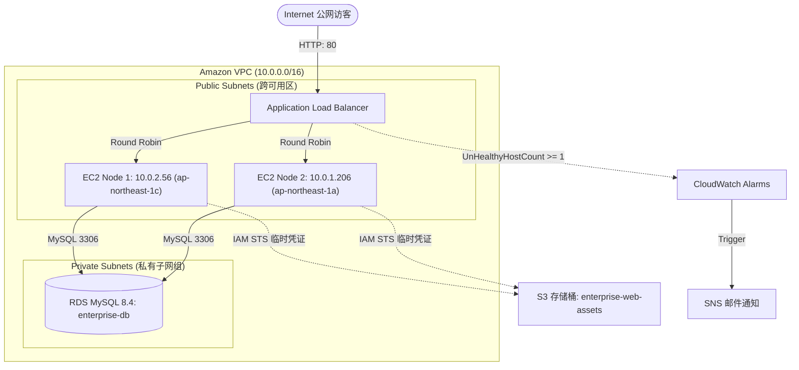

# aws-enterprise-migration
AWS Enterprise Web Application Cloud Migration &amp; High-Availability Solution (Multi-AZ, ALB, RDS, S3, IAM, CloudWatch)个人尝试
# AWS 企业网站云上高可用架构迁移与容灾方案
# AWS Enterprise Web Application Cloud Migration & High-Availability Solution

## 一、 项目背景与业务痛点 (Business Context)

本项目模拟一家中小型电商企业的核心系统上云改造演练。原系统运行于传统 IDC 单台裸金属物理服务器，随着线上访问量增长，面临以下架构瓶颈：
1. **单点故障（SPOF）**：Web 容器（Nginx）与数据库单机混部，缺乏高可用冗余，单点宕机即导致全站瘫痪。
2. **缺乏弹性扩展能力**：无状态应用与有状态持久化数据强绑定，无法应对流量突增时的横向伸缩。
3. **安全边界扁平**：核心数据库与 Web 应用共用公网出入口，缺乏网络层与传输层的隔离防护。
4. **监控与告警滞后**：依赖人工巡检，缺乏端到端指标联动与秒级自动化故障感知机制。

基于 **AWS 架构完善框架（Well-Architected Framework）** 的可靠性、安全性与卓越运维支柱，本项目主导落地了一套跨可用区（Multi-AZ）双活、纵深安全防御、动静解耦且具备自愈能力的企业级云架构解决方案。

---

## 二、 架构拓扑设计 (Architecture Topology)

## 三、 基础设施与配置参数规范 (Infrastructure Matrix)

### 1. 网络与子网拓扑 (Network Topology)
- **VPC**：`enterprise-web-vpc`（CIDR: `10.0.0.0/16`，启用 DNS 主机名与 DNS 解析）
- **公有子网（前端接入层）**：
  - `enterprise-public-sub-1`：`10.0.1.0/24` | 位于可用区 `ap-northeast-1a`（绑定 IGW 路由）
  - `enterprise-public-sub-2`：`10.0.2.0/24` | 位于可用区 `ap-northeast-1c`（绑定 IGW 路由）
- **私有子网（数据持久化层）**：
  - `enterprise-private-sub-1`：`10.0.11.0/24` | 位于可用区 `ap-northeast-1a`（无公网路由）
  - `enterprise-private-sub-2`：`10.0.12.0/24` | 位于可用区 `ap-northeast-1c`（无公网路由）

### 2. 纵深防御网络安全组矩阵 (Security Group Chaining)

| 安全组标识 | 关联对象 | 流量方向 | 协议/端口 | 来源/目标 (Source/Dest) | 设计意图与安全防护逻辑 |
| :--- | :--- | :--- | :--- | :--- | :--- |
| **enterprise-alb-sg** | ALB 负载均衡器 | Inbound | TCP 80 | `0.0.0.0/0` | 系统面向互联网的唯一统一合法接入网关。 |
| **enterprise-web-sg** | EC2 Web 集群 | Inbound | TCP 80 | **`enterprise-alb-sg` (SG ID)** | **链式授权**：仅放行来自 ALB 的反向代理流量，直接阻断公网请求。 |
| | | Inbound | TCP 22 | `3.112.23.0/29` (Tokyo EC2 Connect) | 仅允许 AWS 官方管控网段连接，杜绝全网 SSH 暴力破解。 |
| **enterprise-rds-sg** | RDS MySQL 实例 | Inbound | TCP 3306 | **`enterprise-web-sg` (SG ID)** | **数据层白名单**：仅允许挂载了 Web 安全组的计算节点发起 SQL 查询。 |
| | | Inbound | All | 拒绝所有公网访问 (`Publicly Accessible: NO`) | 物理隔离核心数据资产。 |

---

## 四、 核心架构技术实现 (Technical Implementation)

### 1. 计算层无状态化与元数据自愈 (Stateless Compute)
- 实例均通过编写预置的 Cloud-init **User Data** 脚本进行引导部署，避免手工登入配置。
- 在引导阶段集成 **IMDSv2 (Instance Metadata Service v2)**，动态探测机器私有 IP 与可用区信息生成专属响应页，为后续构建 Auto Scaling Group（ASG）奠定无状态计算标准。

### 2. 托管数据层与动静分离 (Data Tier Decoupling)
- **RDS for MySQL 部署**：
  - 实例标识符：`enterprise-db`（单可用区 `db.t3.micro`，MySQL 8.4）
  - 专用 DB 子网组：`enterprise-db-subnet-group`（严格绑定 2 个私有子网）
  - 开启 AWS KMS 静态数据加密，存储扩容限制为 20 GiB 以保障成本安全。
- **S3 对象存储与免密钥认证 (Zero-Hardcoded Credentials)**：
  - 创建私有存储桶 `enterprise-web-assets-202610` 并开启 Block Public Access。
  - 创建 IAM Role `enterprise-ec2-s3-role` 绑定至 EC2 实例。
  - 应用依托底层 AWS STS 临时安全凭证访问 S3，杜绝了 Access Key/Secret Key 硬编码泄露风险。

---

## 五、 混沌工程验证与容灾测试报告 (Chaos Engineering & Results)

### 实验 1：公网攻击面收敛验证 (Perimeter Security Verification)
- **测试方法**：
  在外部网络环境下，绕过负载均衡器，直接向 Web 节点公网 IP 发送 HTTP 请求，以及使用 PowerShell 向 RDS Endpoint 探测端口：
  `Test-NetConnection enterprise-db.cnuy08kw8rdo.ap-northeast-1.rds.amazonaws.com -Port 3306`
- **实验结果**：
  - 直连 EC2 提示 `Connection Timed Out`（安全组直接将公网非法握手包丢弃）。
  - RDS 连接探测返回 `TcpTestSucceeded : False`，私有隔离验证通过。
  - ALB 统一域名仍可秒级分发至 Node 2 与 Node 1。

### 实验 2：节点故障注入与自动化自愈 (Fault Injection & Self-Healing)
- **测试方法**：
  登录 `enterprise-web-1`（`ap-northeast-1c`），主动执行命令关停 Web 服务：
  `sudo systemctl stop nginx`
- **观测指标与自愈结果**：
  1. **ALB 目标组判定**：连续健康检查失败，在 30 秒内将 Node 1 状态置为 `Unhealthy (Health checks failed)` 并停止分配新流量。
  2. **终端访问表现**：客户端持续请求网站，流量 100% 自动平滑路由至健康的 Node 2（`ap-northeast-1a`），业务达成 **零中断（Zero Downtime）**。
  3. **CloudWatch 告警触发**：指标 `UnHealthyHostCount` 触碰阈值（蓝线跃升至 1），告警状态由 `OK` 翻转为 `In alarm`。
  4. **SNS 自动化通知**：联动 Amazon SNS 在 60 秒内向架构师/运维邮箱自动投递故障警报邮件。

---

## 六、 成本优化与资源治理 (FinOps Strategy)

1. **零账单防线 (AWS Budgets Guardrail)**：首发配置 $1/$3 零支出告警与预测性警报，防止静默扣费。
2. **架构级降本选型**：
   - 第一阶段采用安全组链式授权代替 NAT Gateway，为企业节约约 $32/月的固定网络开销。
   - 静态媒体资源剥离至 S3 存储，降低了 Web 实例挂载高性能 EBS 的容量需求与开销。
   - 严格在 AWS Free Tier 额度内选型（EC2 `t2.micro`、RDS `db.t3.micro` 20GB）。
3. **安全清理 Runbook**：制定明确的资源反向下线方案，保障实验与测试完成后的安全销毁闭环。
